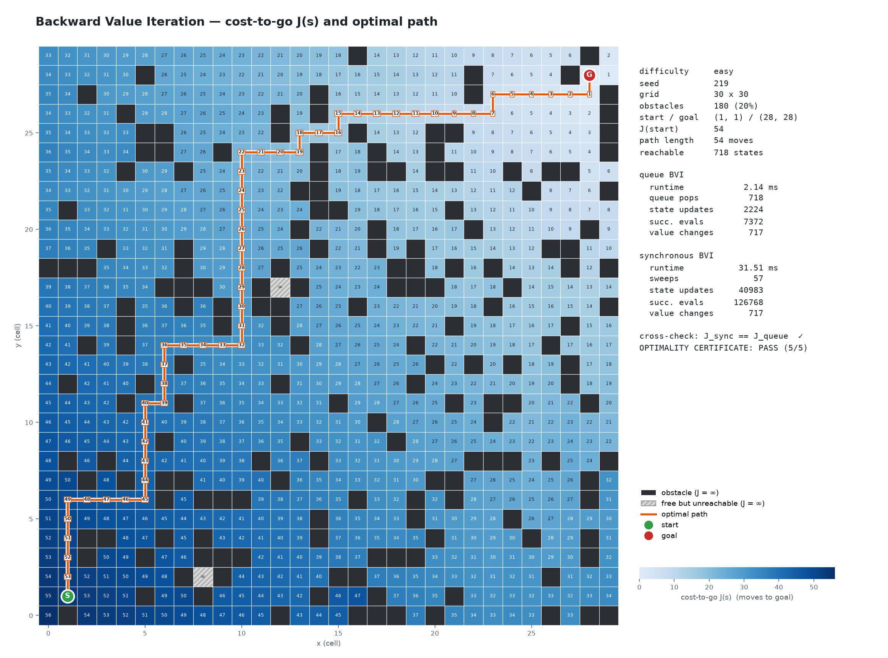
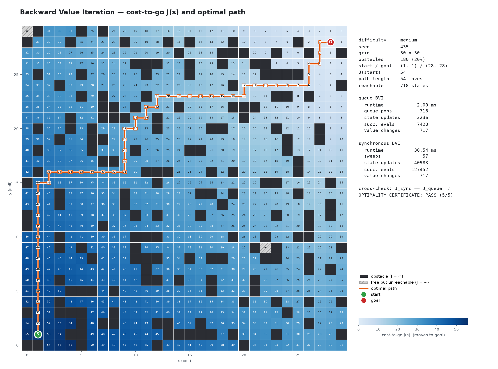
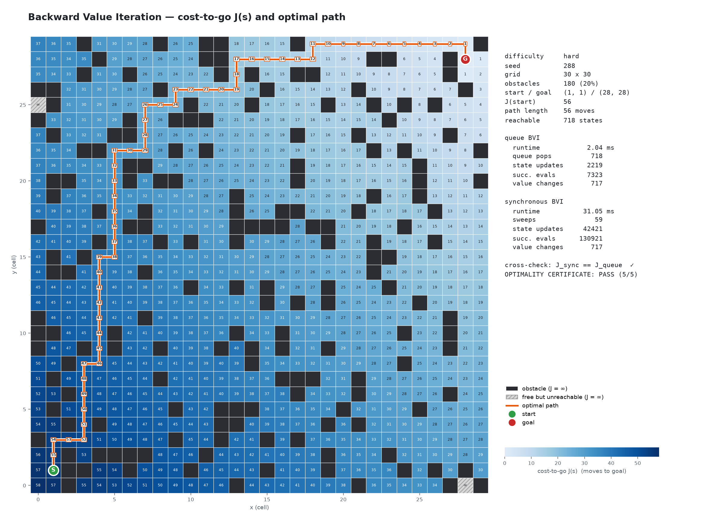
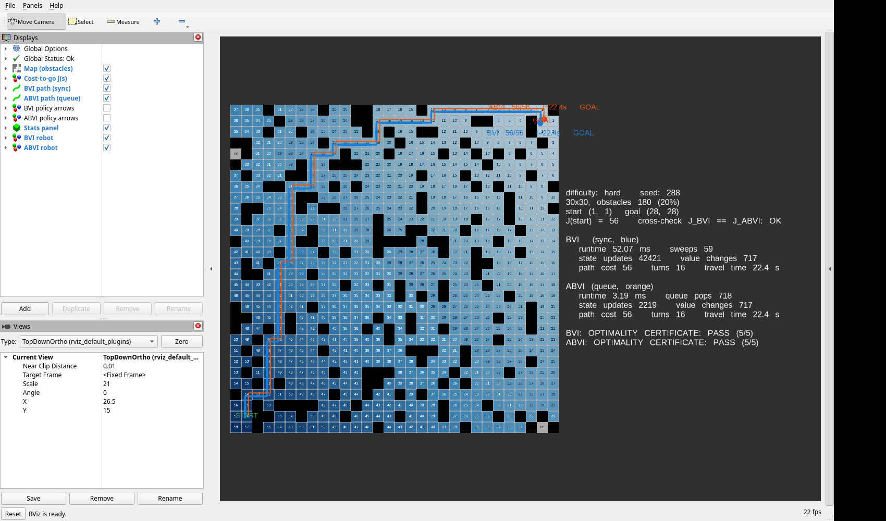
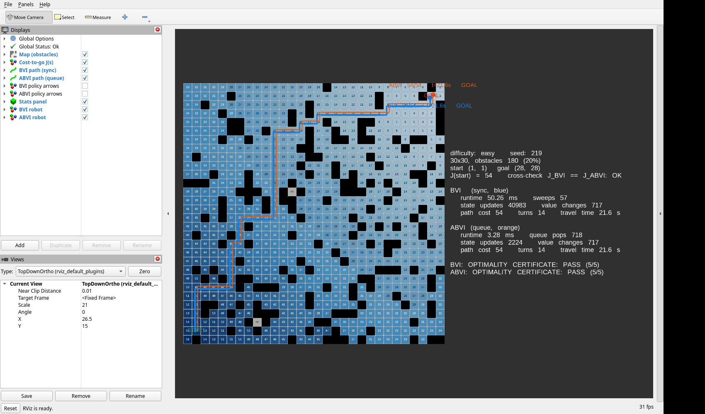
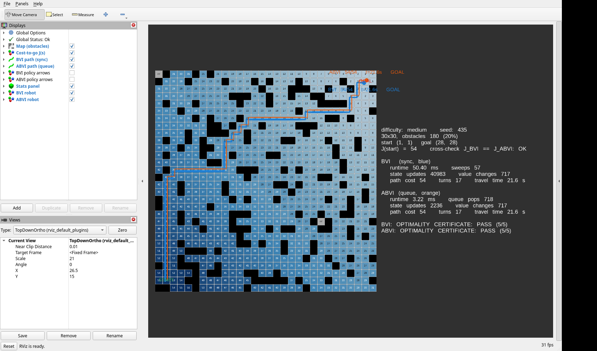
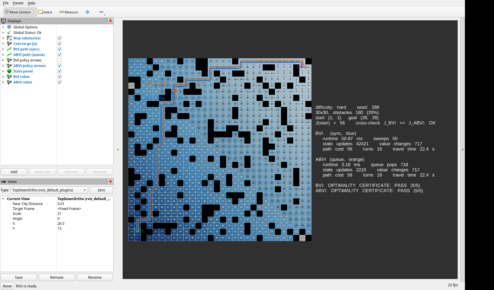
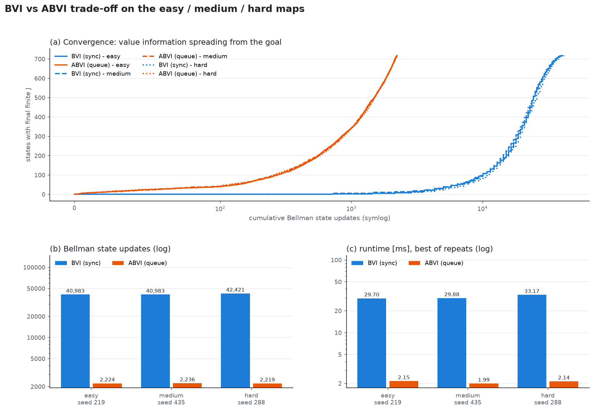
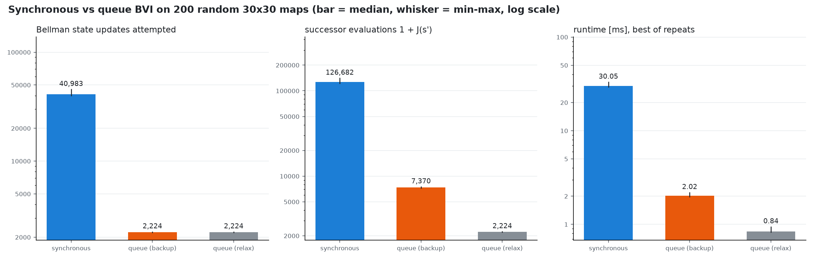

# Assignment 1: Backward Value Iteration on a 30×30 grid (ROS 2)

**Setup.** 30×30 grid, exactly 180 random obstacles (20 %), start (1,1), goal (28,28).
Actions are N/S/E/W with cost 1.
**Stack.** ROS 2 Humble (rclpy) and RViz2 on Ubuntu. The same planning core also runs standalone on macOS.

## 1. Requirements → evidence

| # | requirement | where it is shown |
|---|---|---|
| 1 | Install ROS 2, build the map, robot at the start | ROS 2 Humble workspace in `ros2_ws/`; `/map` OccupancyGrid; robots start at START (§4) |
| 2 | Visualize cost-to-go values | `/bvi_values` heat-map + integer labels (§4), matplotlib figures (§3) |
| 3 | Show the optimal path | `/bvi_path` (blue) and `/abvi_path` (orange) |
| 4 | RViz2 robot navigation along the path | two animated robots on `/bvi_robot`, `/abvi_robot` (§4 mid-run vs at goal) |
| + | two BVI algorithms compared, optimality proof, difficulty levels | §2, §5, §6 |

## 2. Algorithms (both implemented by hand in `bvi_core/bvi.py`)

Bellman equation: **J(goal) = 0, J(s) = min over s' ∈ Succ(s) of [1 + J(s')]**, and J = ∞ for obstacles and unreachable cells.

| | A. synchronous BVI (ordinary) | B. queue ABVI (asynchronous) |
|---|---|---|
| update | every free state, every sweep, from the previous sweep's values J_i | only predecessors p of a state y whose value just changed |
| backup | min over Succ(s) of 1 + J_i(s') | min over Succ(p) of 1 + J(s') (new values used immediately) |
| order | sweep 1, 2, 3, … | FIFO `collections.deque` (correct because all costs are 1) |
| stops when | a full sweep changes nothing | the queue is empty |

"Pred says **who** to update, Succ says **how** to compute the value."
Path extraction: follow π(s) = argmin over s' of [1 + J(s')] from the start.

## 3. Cost-to-go maps (standalone matplotlib)

| easy (seed 219) | medium (seed 435) | hard (seed 288) |
|---|---|---|
|  |  |  |

Policy arrows, hard map: 

## 4. RViz2 (real screenshots)

| hard, robots moving | hard, robots at goal |
|---|---|
|  |  |

| easy at goal | medium at goal | hard, policy arrows (ABVI) |
|---|---|---|
|  |  |  |

## 5. Six runs: {easy, medium, hard} × {BVI, ABVI}

Runtimes are from the Mac (M2 Pro). On the Linux ROS machine, sync takes about 50 ms and ABVI about 3.2 ms; all counts are identical on both machines.
Travel time = path cost × 0.4 s per move.

| map | seed | algorithm | sweeps / pops | state updates | successor evals | value changes | runtime [ms] | J(start) | turns | travel [s] | certificate |
|---|---|---|---|---|---|---|---|---|---|---|---|
| easy | 219 | BVI (sync) | 57 sweeps | 40,983 | 126,768 | 717 | 29.70 | 54 | 14 | 21.6 | PASS |
| easy | 219 | ABVI (queue) | 718 pops | 2,224 | 7,372 | 717 | 2.15 | 54 | 14 | 21.6 | PASS |
| medium | 435 | BVI (sync) | 57 sweeps | 40,983 | 127,452 | 717 | 29.88 | 54 | 17 | 21.6 | PASS |
| medium | 435 | ABVI (queue) | 718 pops | 2,236 | 7,420 | 717 | 1.99 | 54 | 17 | 21.6 | PASS |
| hard | 288 | BVI (sync) | 59 sweeps | 42,421 | 130,921 | 717 | 33.17 | 56 | 16 | 22.4 | PASS |
| hard | 288 | ABVI (queue) | 718 pops | 2,219 | 7,323 | 717 | 2.14 | 56 | 16 | 22.4 | PASS |

**Reading the trade-off.**
* **Same answer:** both algorithms reach the unique Bellman fixed point. Every cell has the same J, so path cost and travel time are equal.
* **Synchronous BVI** needs (max J + 1) sweeps × 719 states, about 41k backups. It wastes most of them: in early sweeps almost every state is still ∞, and in late sweeps almost every state is already final.
* **Queue ABVI** only touches states next to the moving "wavefront". That is 718 pops and about 2.2k backups, **≈ 18× fewer**.
* **Scaling:** sync work grows roughly as |X| × diameter, while queue work grows as about 4|X|.

### Benchmark: 200 random reachable maps (seeds 10000–10207, 8 disconnected skipped)

| metric (mean / median) | synchronous BVI | queue BVI (Bellman backup) | queue BVI (edge relax) |
|---|---|---|---|
| runtime [ms] | 30.19 / 30.05 | 2.03 / 2.02 | 0.84 / 0.84 |
| state updates attempted | 41,041 / 40,983 | 2,222 / 2,224 | 2,222 / 2,224 |
| successor evaluations | 126,920 / 126,682 | 7,370 / 7,370 | 2,222 / 2,224 |
| successful value changes | 716 / 717 | 716 / 717 | 716 / 717 |
| sweeps / queue pops | 57.1 / 57 sweeps | 717 / 718 pops | same |
| optimal path length | 54.3 / 54 | same | same |

The "edge relax" variant sets J(p) ← min(J(p), 1 + J(y)) without recomputing the full minimum. It gives the same J and is cheaper still.
All timings are a few milliseconds of CPython. The update counts are the hardware-independent comparison.

## 6. Mathematical optimality certificate (`bvi_core/verify.py`)

This check is independent of the algorithm. It runs in the tests, in the standalone demo, in the planner node, and in a **separate ROS node** that rebuilds J from `/map` alone.

| check | statement | meaning |
|---|---|---|
| C1 | J(goal)=0, every obstacle has J=∞ | boundary conditions |
| C2 | J(s) = min over s' of [1 + J(s')] for all 719 free non-goal states (residual 0) | J is a Bellman fixed point |
| C3 | J(s) < ∞ ⇔ s is connected to the goal | the ∞ cells are exactly the unreachable ones |
| C4 | \|J(u) − J(v)\| ≤ 1 on every edge, and J ≥ Manhattan distance | every path from s has ≥ J(s) moves (lower bound) |
| C5 | the path is legal and has exactly J(start) moves | the bound is achieved |

C4 + C5 ⇒ the path is optimal. C1–C3 ⇒ J is the unique optimal cost-to-go.
Sample output (easy map): `OPTIMALITY CERTIFICATE: PASS (5/5) … C5 path optimal: legal=True, moves=54, J(start)=54`.
The tests also inject errors (a wrong J value, a detour path, a finite J on an unreachable cell) and confirm the certificate catches each one.

## 7. Easy / medium / hard selection

* Pool: seeds 0–499, one map each (exactly 180 obstacles); 480 connected, 20 disconnected and rejected.
* Rank by (stretch = J(start)/54, turns, seed) and pick the 20th, 50th and 90th percentiles.
* Result: easy 219 (stretch 1.000, 14 turns), medium 435 (1.000, 17 turns), hard 288 (1.037, 16 turns). Saved in `results/difficulty_seeds.json`.
* **Honest note:** with start and goal in opposite corners and 20 % uniform obstacles, stretch saturates. The median is 1.0 and the maximum only 1.11, because a monotone staircase path almost always exists. Easy vs medium is therefore decided by the turn-count tie-breaker.
* These levels describe **navigation** difficulty. BVI's computational cost is almost the same across them, because it always solves the whole reachable state space.

## 8. Verification summary

| check | result |
|---|---|
| unit/integration tests (`pytest`, macOS and Linux) | **433 passed** |
| sync J == queue J == relax J on 60 test maps + 200 benchmark maps + all demos | identical on every cell |
| path legality, J drops by exactly 1 per step, len − 1 = J(start) | passed (all maps) |
| optimality certificate | PASS 5/5 for all maps, both algorithms, in the planner and the independent ROS checker |
| ROS launch, all 3 difficulties, headless + RViz2 | both robots reach the goal, no errors, clean shutdown |

## 9. Assumptions and limitations

* Cells are (x, y) with (0, 0) at the bottom-left, the same as the ROS OccupancyGrid. Resolution is 1 m per cell.
* Rejected maps are logged, never hidden: the pool records disconnected seeds, and the demo prints any seed it skipped.
* The equal-cost tie-break order is N, S, E, W. Other optimal paths of the same cost exist.
* ROS 2 Humble can be installed from apt (Ubuntu 22.04) or in user space via RoboStack (conda); both were tested.
* The robot is a visual marker moving cell by cell (kinematic animation). There is no physics simulation.
